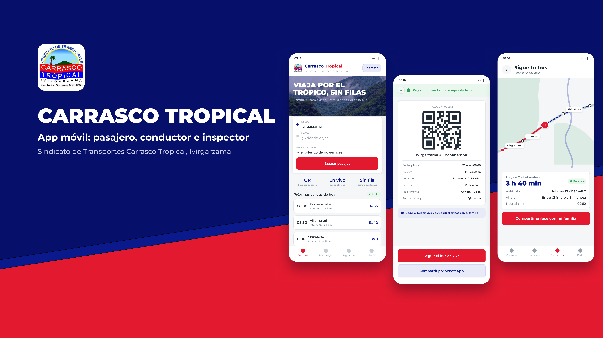

# Carrasco Tropical

Sitio web del **Sistema de Cobro de Pasajes y Ubicación de Transportes en Tiempo Real** del Sindicato de Transportes Carrasco Tropical (Ivirgarzama, Cochabamba, Bolivia).



## Páginas

| Página | Qué hace |
| --- | --- |
| `index.html` | Portada: buscador, tablero de salidas en vivo, rutas populares, mapa de la flota |
| `viajes.html` | Viajes del día, elección de asiento y tipo de pasajero, pasaje de muestra con QR |
| `mapa.html` | Flota en vivo con filtro por ruta |
| `seguimiento.html` | Seguir un bus con el código del pasaje y compartir el enlace |
| `verificar.html` | Verificación pública de pasajes (válido, ya utilizado, anulado, inválido) |
| `tarifas.html` | Rutas, paradas, horarios y tarifas por tipo de pasajero |
| `guia.html` | Normas de diseño (colores, tipografía, controles) |

## Cómo verlo

El JavaScript usa módulos, así que hace falta un servidor local (abrir el `.html` con doble clic no funciona):

```bash
python3 -m http.server 5173
```

Luego abre <http://localhost:5173>.

## Cómo editar

- Las páginas `.html` se generan con `node build.mjs`. Se edita `build.mjs`, no los `.html`.
- Rutas, paradas, tarifas, flota y horarios están en `js/data.js`.
- Colores y tipografía: `css/tokens.css`. Estilos: `css/site.css`.
- Reglas de diseño: `DESIGN.md`.

## Datos de muestra

Rutas, tarifas, vehículos y horarios son **de muestra** hasta recibir los datos oficiales de la directiva. La ubicación de los buses es simulada a partir de los horarios.

## Créditos

Fotos de Wikimedia Commons con licencias libres; los autores están en `img/fotos/creditos.json` y en el pie de cada página. Mapa: © OpenStreetMap.
